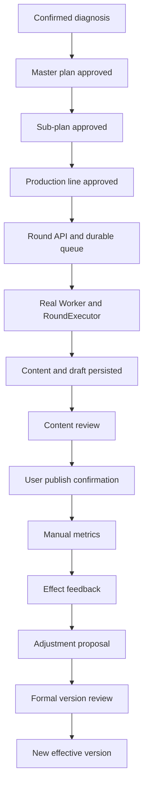

# T9-C Mainline Acceptance Matrix — 2026-11-05

This document records the current acceptance evidence on `main`. It is an evidence map, not a completion claim. T9-C remains open until the integrated path and the remaining negative cases are automated.

## Mainline evidence

| Business segment | Current test/evidence | What it proves | Remaining gap |
|---|---|---|---|
| Confirmed diagnosis → master plan → sub-plan → production line → round/queue | `tests/test_t8_full_api_happy_path.py::test_confirmed_diagnosis_to_production_task_api_happy_path` | API-created diagnosis confirmation and approved version chain; round bound to approved sub-plan and production-line versions; durable queue submission; asset permission snapshot | This test creates an executor-shaped `production_task` directly. It does not consume the queued round in the same test. |
| Queue → real Worker → RoundExecutor → content/draft | `tests/test_t8_b_worker_api_dispatch.py::test_round_run_api_worker_executes_real_round_executor`; PR #71 | Real worker dispatch and real RoundExecutor persistence of content and draft; PR #71 adds sub-plan round/task/version lineage and downstream review/publish/effect feedback on the same produced artifact | Not yet joined to the confirmed-diagnosis and approved production-line setup in one API-driven test. |
| Content review → publish confirmation → metrics → effect feedback | `tests/test_t8_content_lifecycle_api_acceptance.py::test_content_review_publish_metrics_and_effect_feedback_api_chain` | API review, duplicate approval dedupe, user-confirmed publish, duplicate publish confirmation dedupe, manual metric snapshot, effect feedback evidence | Currently starts from seeded content/draft rather than the real Worker output from the preceding segment. |
| Effect feedback → adjustment proposal → formal version governance | `tests/test_t8_content_lifecycle_api_acceptance.py::test_feedback_adoption_requires_formal_version_review_and_preserves_history`; PR #75 | Adoption creates a proposal only; explicit review activates the exact version; previous round binding and source snapshot remain immutable; rejected proposal does not replace active version | Need downstream stage/round gating proof that the new effective version is actually consumed, plus broader cross-version/tenant/rollback negatives. |
| Worker tenant isolation and retry identity | PRs #72 and #73 | Concurrent tenant-specific SQLite/output writes; missing/mismatched tenant context rejected before mutation; retry preserves task/tenant/actor/snapshot identity | These are test-factory/context consistency checks, not full RBAC or tenant-membership authorization. |

## Current end-to-end evidence graph



The graph represents the intended joined path. The current tests prove its segments, but not yet one uninterrupted run from A through N.

## Required T9-C follow-up

1. Add one API-driven integration test that begins with a confirmed diagnosis, approves the master/sub-plan/production-line versions, opens and submits a round, consumes the durable queue with a real Worker and RoundExecutor, and continues with the exact produced content through review, publish confirmation, metrics, effect feedback, adjustment proposal, and formal version review.
2. Replace direct task construction in the joined test with the task actually created by RoundExecutor. Keep SQL limited to fixture preparation and read-only provenance assertions.
3. Assert one-to-one task/content/draft lineage, tenant identity, master/sub-plan/production-line version IDs, stage ID, asset permission/privacy snapshots, and historical round/version immutability.
4. Add negative cases for rejected review, duplicate requests, worker failure/recovery with uncertain external side effects, tenant boundary and authorization denial, stale/cross-version feedback, and rejected/rolled-back adjustment.
5. Inspect and explicitly resolve the Outbox requirement. Current mainline acceptance evidence uses `content_events`; no dedicated Outbox consumer has been demonstrated by the tests mapped above. Do not treat a content event row as proof of Outbox delivery/consumption.

## Commands

```bash
pytest -q tests/test_t8_full_api_happy_path.py
pytest -q tests/test_t8_b_worker_api_dispatch.py
pytest -q tests/test_t8_content_lifecycle_api_acceptance.py
pytest -q tests/test_task_worker.py tests/test_task_queue.py tests/test_recovery_queue.py
```

## Status

- PR #71: merged; real Worker/Executor and sub-plan lineage evidence.
- PR #72/#73: merged; tenant output isolation, context guard, retry identity.
- PR #75: merged; formal feedback adoption/version governance and historical snapshot preservation.
- T9-C #25: **OPEN**. This matrix does not satisfy the missing joined-path requirement by itself.
